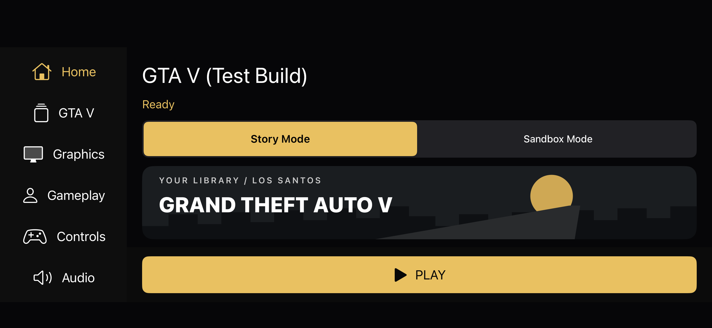

# Native 0.45 — library launcher and real settings

Status: integrated CI **39672234412 passed** for executable source **7030977aee7f5e5d87a206931d123d9901f793ca**. Native **0.45.0 / build 45** unsigned iOS ARM64 IPA has been downloaded, integrity-checked and preserved. Published as the native-0.45 GitHub prerelease with exactly one uploaded asset: the IPA. GitHub reports the same SHA256. Physical iPhone verification is pending.

[CI run](https://github.com/yosnuffyyy/gta5loader/actions/runs/39672234412) · [source](https://github.com/yosnuffyyy/gta5loader/commit/7030977aee7f5e5d87a206931d123d9901f793ca) · [release](https://github.com/yosnuffyyy/gta5loader/releases/tag/native-0.45)

## Changes

- New charcoal/gold native library composition, original procedural Los Santos banner, responsive sidebar/horizontal navigation and persistent PLAY dock. Story/Sandbox selection is explicit. Graphics, Gameplay, Controls, Audio, Advanced, Game Files and Diagnostics are separate scrolling pages.
- One 128-byte typed settings value, range/schema validation, versioned NSUserDefaults dictionary, one-time legacy migration, presets, Custom tracking and frozen launch configuration. Reset preserves folder bookmarks and both save roots.
- Real original-engine command-line settings for scale/base/cap/texture/FXAA, shadows, reflections, water, particles, grass, post FX, SSAO, filtering, LOD, motion blur, city density and population variety. Exact numeric domains were checked against original bytecode consumers; shadow -1 maps to engine off/0 rather than assuming all zeros mean off.
- Master gain and mute affect real native stereo PCM, preserving sample rate/ring progression. Independent touch/controller look sensitivity, invert-Y and touch enable use the existing ordered input bridge. Source switching, safe neutralization, fullscreen and controller mappings remain intact. Master volume controls the mixed stereo output; it does not pretend to offer unimplemented per-bus mixing.
- Startup-only Metal representative color/depth target validation and minimum headroom rejection. This is not a total scene memory-budget guarantee.
- Requested/validated launch logs and original effective-setting snapshots at the engine-owner pad boundary every five seconds. No main-thread reads of mutable engine settings and no per-draw configuration work.
- Existing/V2 renderer and CPU-core choices remain separate; Muguet is explicitly unavailable until its game services are integrated. The independent Muguet migration branch is unchanged.

## Source organization

| Files | Responsibility |
| --- | --- |
| `native-ios/launch/settings.h`, `NativeSettingsStore.inc` | Typed model, domains, presets, bounded arguments, persistence and legacy migration |
| `native-ios/launch/options.h`, `renderer/native_scene.c`, `threading/native_threads.c` | Frozen launch snapshot, existing mode publication and safe original-engine argument delivery |
| `native-ios/launch/effective_settings.h`, `settings-contract.json` | Pinned original setting destinations, requested/effective reporting and bytecode provenance |
| `native-ios/launch/device_settings.h`, `App.m` | Representative device preflight, rejection, launch and host setting lifecycle |
| `native-ios/ui/NativeLibraryArt.inc`, `NativeSettingsUI.inc`, `NativeDashboard.inc` | Static original artwork, navigation, scrolling, prominent PLAY, real model controls and unavailable explanations |
| `native-ios/input/native_input.*`, `NativeControls.inc` | Source-specific sensitivity, inversion and touch enable through the existing synchronized bridge |
| `native-ios/audio/native_audio.*`, `native_pcm.h` | Validated atomic PCM master gain and mute |
| `native-ios/launch/test_*`, `input/test_input.c`, `input/test_ui.m`, `audio/test_output.m` | Model, original consumers, Metal allocation, production UIKit/input and PCM regression coverage |
| `native-ios/ci-convert.sh`, `compile-native.mjs`, `Info.plist` | Integrate checks, dependency-aware host cache, version/build 0.45.0/45 |

No shader translator, draw pipeline, resource-retirement policy, archive budget, runtime implementation or original game assets were changed. The original procedural artwork uses UIKit drawing, system typography and SF Symbols; it contains no copied Rockstar launcher assets. Landscape uses a compact banner and places Story/Sandbox selection above it. Artwork redraws on resize instead of stretching a cached portrait image.

## Supported settings and limits

The complete mapping and lifecycle contract is in [native-ios/launch/SETTINGS.md](native-ios/launch/SETTINGS.md).

640×360 at 50%, 70% and 100% produces 320×180, 448×252 and 640×360. Exact 16:9 bases up to 1280×720 and additional scales are offered with actual rounded pixel previews. Physical display resolution is not changed; HUD shares the internal render target.

15, 20 and 30 FPS use original 60 Hz divisors 4, 3 and 2. 24/40 do not map to that limiter; 60/uncapped simulation is not validated. Off/FXAA are available; MSAA2/4, TXAA/TAA are unavailable. Texture levels are the engine's Normal/High/Very High, not invented Ultra Low/Low mip tiers. Independent music/SFX/dialogue/radio bus controls, haptics, separate vehicle/pedestrian density, native display sizing and unverified effects are explained as unavailable.

Higher quality values and larger resolutions require physical-device visual/memory validation. Existing timer behavior is unchanged: the original isolated timer fixture reproduces bounded delta time and loss of elapsed simulation time below 15 updates/second; this launcher task does not repair that separate runtime issue. Passing numeric settings to original engine consumers does not prove every possible world/shader combination, sustained FPS or sufficient memory for every scene.

## Validation evidence

- Local settings model: 100,198 recorded checks (including 100,000 bounded serialization iterations); 19 generated argv fixtures, 10 original publication fixtures, bounds/NaN/immutable copies and PCM gain checks.
- Original engine: 836 checks using C-generated argv, original main/argument parsing, original numeric readers, hash-verified CApp override blocks and original SetFrameLock. Engine SHA256 e65bec476e8fd8125515150c24037c9bd0d0c46530e3544f9d389ab108b5592e. Test-only parameter binding isolates consumers; production engine instructions are unchanged.
- Preserved launch bridge: 24 option checks, 5,136 untouched-byte checks, 169 original startup/script assertions, both modes and separate namespaces. Host tests do not prove free-roam gameplay.
- Input: held/released/simultaneous actions, analog normalization, drift, transitions, disconnect/focus, multitouch and concurrency pass locally. New tests cover independent sensitivities, inversion and touch disable.
- macOS production AVAudioEngine offline callback: 1,024 exact stereo output frames across unity/half/mute/restored gain passed under ASan/UBSan in the final integrated run. No physical speaker/audio-assets claim.
- Production UIKit simulator: 267 assertions across 33 asynchronous steps; all settings pages, persistence/migration, reset, unsupported values, source switching, fullscreen, scrolling, compact/wide landscape PLAY bounds and accessibility. Engine entry points abort in this UI fixture; no gameplay is claimed. The final four added checks keep Story/Sandbox selection within the visible scroll bounds at 667 and 932-point landscape widths. Saved portrait, compact/wide landscape, Graphics, Audio and Advanced previews were visually inspected. These are production UIKit simulator captures, with explicit fixture audio/engine stubs, not phone gameplay screenshots.
- CI caught a missing UIKit method declaration and an autoreleased preflight diagnostic string crossing an inner pool. Both were corrected before release. The final integrated run passes the corrected preflight under ASan/UBSan: 18 real host-Metal scale/base target pairs plus nil-device, invalid-config and insufficient/zero-headroom rejection. The final CI completed successfully, including existing renderer/core execution, buffer bytes, pixel/SRV/shadow transitions, query/readback, worker/mailbox, memory, archive, input and PCM checks. ASan/UBSan and the existing TSan fixtures passed. The shader audit compiled 4,808 modules and 4,808 Metal pipelines, including 500 clip shaders, with zero failures; 111 pre-existing untranslated records remain outside that audit.

## Performance and memory

No renderer execution optimization, resolution reduction of the default profile or FPS improvement is claimed. Configuration construction is startup-only. Local Windows O1 100,000 argv serializations took 123 ms (about 1.23 microseconds each); sanitizer/host numbers are not comparable to an iPhone session.

Five same-host O1 input runs: baseline median 12.197 ms versus launcher 12.292 ms per 100,000 event/consume pairs. Difference 0.095 ms over the whole workload; this is not an input-to-display measurement or meaningful gameplay speedup. Original bounded queue and allocation-free input hot path remain.

Launcher artwork is procedural and static, without bitmap decoding, blur, animation loop, display link or directory rescans. PCM gain has a unity fast path and one lock-free atomic read per callback. The settings snapshot is 128 bytes. Launcher process-memory and idle-CPU before/after comparison and physical iPhone performance remain unmeasured.

## Preservation

Base native source: remote 6ee0c328af8dde211fca95580db669cf3531897b, executable reference fb7a11e2c0571c5187b98411807226edb7fcc863 (0.44). Work is isolated in work/native-launcher-045. No protected Desktop packages, original game assets, save files or previous IPAs were modified. All 44 previous IPA sizes and SHA256 values were rechecked and matched the preservation manifest. No changes to deployed main or the Muguet branch. App bundle ID and display name/icon are retained.

## Build and artifact

- Executable source: `7030977aee7f5e5d87a206931d123d9901f793ca`; source tree `71c5ec6489456361d29cba20220935e4bd38143b`.
- CI: `39672234412`, job `119472822503`, macos-15; **success**. Full evidence artifact `12380838132`; unsigned IPA artifact `12381210514`.
- Version/build: **0.45.0 / 45**; bundle `io.github.yosnuffyyy.gtanativeprobe`; display name **GTA V (Test Build)**.
- File: `GTA-Native-Probe-0.45-unsigned.ipa`, **105,028,704 bytes**. Local copy: `outputs/GTA-Native-Prototype/`.
- IPA SHA256: `cbe19d8ab8d9073071c4eff426189ea1d5f6898600435e81daf6cc2d6384588f`.
- Mach-O: iOS ARM64, UUID `72CA719D-8B41-3711-A6FC-0277BEE9F402`. Icon catalog present; unsigned packaging; no web directory, RPF archives, wasm/HTML/JS files or signing identities included.
- GitHub artifact ZIP SHA256: `81458bcd706eb795bde1b1cfbb587ae80a660ac19f25440d9b9bfaa43a0052d4`; evidence ZIP SHA256: `2d6533ef6b33c4ef9910699e77f071fa82fa35248314e975ac75160ca9365081`.
- Packaging growth versus preserved 0.44: **26,869 bytes**. Package size is not process footprint or runtime memory usage.
- Permanent selected test evidence, screenshots and packaging audit: [evidence/0.45](evidence/0.45). Full CI artifact retention is limited; the selected evidence is committed with this report.

## UI previews

Production UIKit in the iOS 26.2 simulator; the 667/932-point images test landscape bounds, not a claim of physical rotation or gameplay. The sidebar and content scroll independently. PLAY stays fixed. Large accessibility text remains scrollable. No copied Rockstar launcher art/fonts are included.

[Portrait](evidence/0.45/ui-dashboard.png) · [Compact landscape](evidence/0.45/ui-library-landscape-667.png) · [Graphics page](evidence/0.45/ui-Graphics.png)

## Next iPhone checks

1. Retain 0.44 for rollback. Install 0.45 with the same app identity; verify remembered folder access and both save namespaces.
2. Confirm launcher scrolling and fixed PLAY, landscape/portrait layout, Settings navigation and saved Custom values after restart.
3. Start Story and Sandbox separately at Low, 640×360, 100%, 30 FPS. Verify original mission/free-roam behavior and both renderer/core selections.
4. Compare 50/70/100% at the same base. Export logs and check validated launch dimensions and requested/effective values. Test 15/20/30 cap without claiming achieved FPS from the setting label.
5. Change master volume/mute and touch/controller sensitivity/inversion in the paused settings page. Verify real sound, no stuck inputs, source switching and fullscreen recovery.
6. Test higher-quality settings gradually while observing memory and visual correctness. Do not assume a successful preflight guarantees long-session headroom.

## Compact report

Native 0.45 adds a native library launcher and centralized, validated settings pipeline to the existing 0.44 AOT runtime. It preserves Story/Sandbox publication and separate saves, renderer/core fallbacks and Muguet isolation. Verified local evidence: 100,198 recorded C checks (100,000 serialization iterations), 836 original engine setting checks across 19 configurations, existing 169 startup/script assertions, and input regressions. Integrated macOS ASan/UBSan confirms 1,024 real AVAudioEngine offline output frames at unity/half/mute/restored gain. Unsupported MSAA/higher caps/audio buses/Muguet remain explicitly unavailable. No phone FPS, audible hardware, complete settings-combination compatibility or launcher memory improvement is claimed. Final CI 39672234412 passed; production UIKit 267 checks, original engine settings 836 checks, 4,808 shader modules and Metal pipelines with zero failures, plus existing sanitizer/renderer/runtime coverage. Executable source 7030977aee7f5e5d87a206931d123d9901f793ca. IPA 0.45.0/build45, 105,028,704 bytes, SHA256 cbe19d8ab8d9073071c4eff426189ea1d5f6898600435e81daf6cc2d6384588f. Physical-device gameplay, visuals at higher quality, memory/FPS and speaker output remain unverified.
