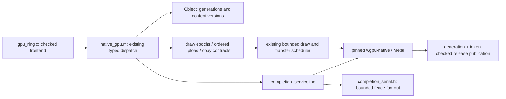

# Renderer V2 — staged execution-core design

Baseline: native head `19b1c9bbf770885b0ecdfc27093648c07ba6505b`, executable `68c1394b3d067e73aacb17bd3d7fe39091708315`. Independent branch `renderer-v2-experimental`. Existing renderer remains default. One backend per session; no duplicate game resource sets.

## First vertical slice

Opcode 46 is END_QUERY. `native_gpu.m:end_query` dispatches type 1/5 to exact occlusion aggregation; types 0/2/3 use asynchronous event replies. Type 2 is an existing CPU timestamp compatibility shim, NOT GPU timing. The 0.39 device report contains 603,610 ENDs = 597,424 event/timestamp + 6,186 occlusion ENDs. Event requests each register a backend callback, although only 104,461 submissions are attributed to this opcode. The counts alone do not identify every repeated fence; new counters and matched tests must establish reuse.

V2 initially preserves each submission boundary. A monotonically increasing **queue-work serial** includes both submissions AND queue writes; queued writes may not yet have been submitted. Multiple replies for the same serial share one completion registration. A successfully completed serial can answer later requests for the identical fence without another driver call. This changes callback fan-out, not rendering, query values, CPU timestamp capture, or GPU retirement. No delayed submission window is introduced in this milestone.

`completion_serial.h` owns fixed pools, complete fence identity and deterministic transitions. `completion_service.inc` adapts these transitions to the pinned backend and existing generation/token-checked result publication. 128 replies maximum, as before; bounded pressure handling polls only when full. Success, cancellation and error remain distinct. Immutable callback contexts outlive device/instance release. No callbacks retain Object pointers or old result addresses.

## Responsibility boundaries

The existing core retains immutable uniforms, ordered uploads, pass/query segments, bounded drain scheduling, pipeline identity, SRV/UAV semantics and resource retirement. They are reused, not reimplemented or claimed as new wins. Later scheduler work requires measured submission reasons and hazard fixtures before widening boundaries. Observable dependency, readback/query progress, present, staging bounds, latency/feed and shutdown must remain explicit reasons.

## Backend decision and constraints

Keep wgpu-native v29.0.1.1 (`6aed50955d934ac36049ba8d002034841633ae02`), patched HAL29.0.3, Rust1.93.1 and WABT1.0.42. Its C completion API allocates one closure per registration and delegates to core. The pinned `wgpuQueueGetNativeMetalCommandQueue` returns null because the HAL accessor is unavailable. No private interop or parallel direct-Metal queue is justified for this completion fan-out defect. A separate direct-Metal comparative prototype remains deferred until residual backend cost is demonstrated.

Source: [pinned queue API](https://github.com/gfx-rs/wgpu-native/blob/6aed50955d934ac36049ba8d002034841633ae02/src/lib.rs). Queue writes and submission identity must not be conflated; completion never certifies a later unsubmitted write.

The pinned `wgpu-core 29.0.3` crate was independently downloaded and checked against Cargo.lock SHA256 `02da3ad1b568337f25513b317870960ef87073ea0945502e44b864b67a8c77b7`. `device/queue.rs:1515` registers work against the life tracker and explicitly leaves pending-write flushing unimplemented. V2 therefore submits unsent QueueWrite transfers before creating their fence. This corrects a separately tested ordering gap; it is not counted as a performance improvement. Other draw submission boundaries remain unchanged. `queue.rs:1501` runs completion closures after releasing core locks. Native code calls queue submission and device polling only on its service thread; callbacks and the completion pools keep that ownership.

The existing CPU profiler samples its thread clock before the wall clock and ends it after the wall-clock interval and bookkeeping. On extremely short commands the reported CPU duration can exceed wall duration because the sampled intervals differ and clock overhead matters. These values are not precise exclusive instruction costs. The dominant END_QUERY total remains inclusive of draw finalization, submission, backend callbacks and profiling overhead. Paired profiling-on/off runs are required; no clock-overhead subtraction is invented.

## Validation and promotion

Exact bytes for copies/uniforms/query payloads; existing shader fixture tolerance of one UNORM unit remains fixed before comparison. Alternate existing/V2 order, repeat separate processes, record profile-on/off and warm/cold status. Test saturation, delayed/reordered callbacks, ID generation/token reuse, cancellation, error, pending writes and clean shutdown. Run inherited pixel/shader/runtime/input suites. Synthetic gains do not promote V2; device median/p95 regressions over5% require review and matching phase/thermal controls.

## Explicitly deferred work

No complete execution-core replacement is claimed. iPhone13 capability fallback remains a separate milestone: native BC is detected at runtime; missing BC currently fails explicitly, no decoder/conversion cache is invented. Dynamic texture conversion must preserve mips, colorspace, copy/readback and bounded residency before that target is supported.

Timing clamp (10real seconds at10Hz advances6.667engine seconds), audio underruns, production population presets and broader simulation scheduling remain open. No global time multiplier, clamp removal, extra physics updates, density reduction or quality change is included in renderer comparisons. Standard640×360 and30FPS cap remain unchanged.
